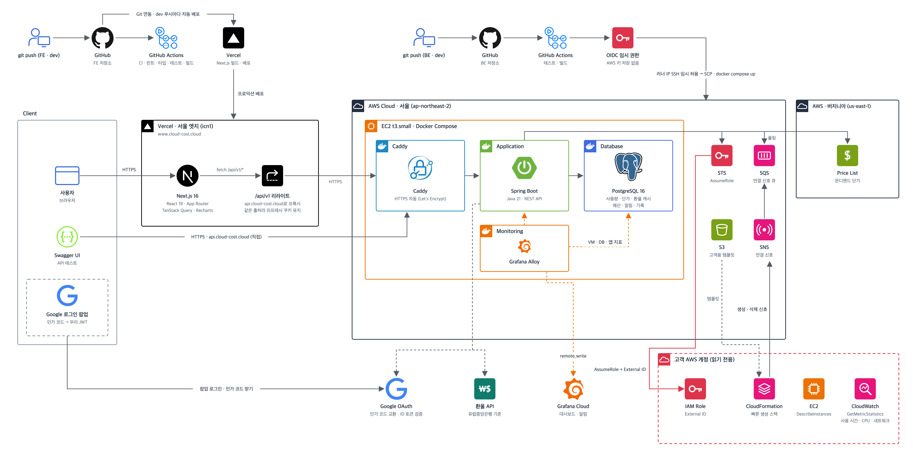

# CloudCost FE

단국대학교 캡스톤 디자인 프로젝트 CloudCost의 프론트엔드입니다. 서비스 주소: https://www.cloud-cost.cloud

## 아키텍처

- **FE**: Next.js 16 · React 19 앱을 Vercel(서울 엣지)에서 서비스합니다. `dev`에 푸시하면 Vercel Git 연동으로 자동 배포되고, GitHub Actions는 린트 · 타입 · 테스트 · 빌드를 검사합니다.
- **API 호출**: 브라우저는 같은 출처의 `/api/v1/*`로 요청하고, Vercel 리라이트(`API_PROXY_TARGET`)가 `api.cloud-cost.cloud`(EC2의 Caddy → Spring Boot)로 넘깁니다. 같은 출처라 HttpOnly 리프레시 쿠키가 그대로 오갑니다.
- **로그인**: Google 로그인 팝업에서 인가 코드를 받아 BE로 보내면, BE가 Google에서 코드를 교환하고 ID 토큰을 검증한 뒤 우리 JWT를 발급합니다.
- **BE**: 구성과 배포 경로는 [CLOUD-COST-BE](https://github.com/cloudcost-team/CLOUD-COST-BE)를 참고하세요.
