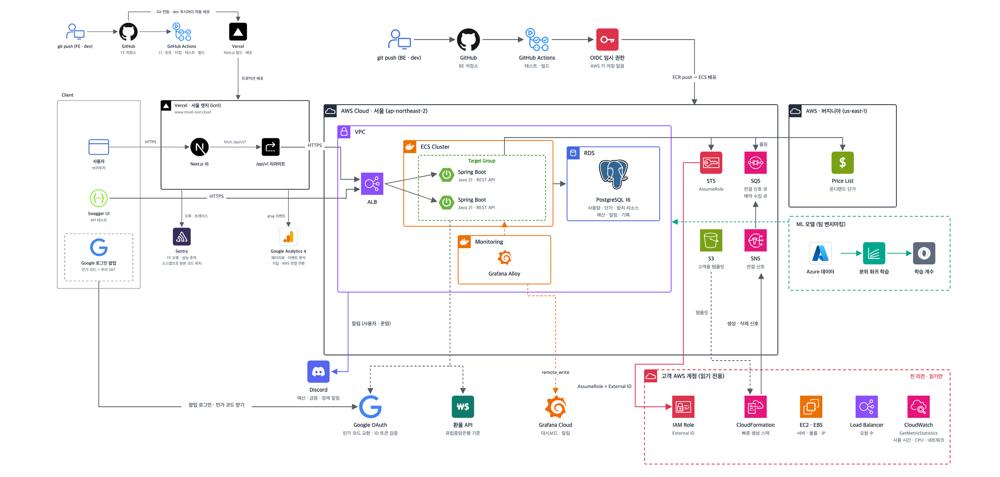

# CloudCost Frontend

> AWS 계정을 **읽기 전용 IAM Role**로 연결하면 EC2 사용 시간과 비용(사용 시간 × 온디맨드 단가 기준)을 보여 주고, 불필요한 리소스와 비용 급증, 절감 가능 금액까지 확인할 수 있는 클라우드 비용 관리 서비스의 프론트엔드입니다.
>
> 고객 AWS 계정의 리소스를 바꾸는 기능은 제공하지 않으며, AWS 계정이 없는 사용자도 체험 모드로 주요 화면을 둘러볼 수 있습니다.

| 구분                     | 링크                                                             |
| ------------------------ | ---------------------------------------------------------------- |
| 서비스 주소              | https://www.cloud-cost.cloud                                     |
| 발표자료 또는 포스터 PDF |                                                                  |
| 프로젝트 결과보고서 PDF  |                                                                  |
| 시연 영상                |                                                                  |
| 백엔드                   | [CLOUD-COST-BE](https://github.com/cloudcost-team/CLOUD-COST-BE) |

## Architecture



- **FE**: Next.js 16 · React 19 앱을 Vercel(서울 엣지)에서 서비스합니다. `dev`에 푸시하면 Vercel Git 연동으로 자동 배포되고, GitHub Actions는 린트 · 타입 · 포맷 · 테스트 · 빌드를 검사합니다.
- **API 호출**: 브라우저는 같은 출처의 `/api/v1/*`로 요청하고, Vercel 리라이트(`API_PROXY_TARGET`)가 `api.cloud-cost.cloud`(BE)로 넘깁니다. 같은 출처라 HttpOnly 리프레시 쿠키가 그대로 오갑니다.
- **로그인**: Google 로그인 팝업에서 인가 코드를 받아 BE로 보내면, BE가 Google에서 코드를 교환하고 ID 토큰을 검증한 뒤 서비스 JWT를 발급합니다.
- **BE**: 구성과 배포 경로는 [CLOUD-COST-BE](https://github.com/cloudcost-team/CLOUD-COST-BE)를 참고하세요.

## Key Features

|     | 영역                                     | 한 줄 요약                                                 |
| --- | ---------------------------------------- | ---------------------------------------------------------- |
| 🔗  | [AWS 연결](#1-aws-연결)                  | 온보딩에서 CloudFormation 링크로 읽기 전용 연결, 연결 관리 |
| 📊  | [대시보드](#2-대시보드)                  | 이번 달 누적 · 월말 예상 · 예산 · 비용 급증 · 절감 기회    |
| 💡  | [절감](#3-절감)                          | 낭비 리소스 목록, 추천 적용 · 트래픽 변화 시뮬레이터       |
| 📈  | [벤치마킹 · 리포트](#4-벤치마킹--리포트) | 비슷한 규모 팀과 비교, 월간 리포트                         |
| 🔔  | [알림 · 설정](#5-알림--설정)             | 헤더 알림, 알림 이력, 예산 · 알림 설정                     |
| 🧪  | [체험 모드](#6-체험-모드)                | AWS 계정 없이 서버 구성을 정해 같은 화면 체험              |

### 1. AWS 연결

| 화면                    | 경로                    | 내용                                       |
| ----------------------- | ----------------------- | ------------------------------------------ |
| 로그인                  | `/login`                | Google 로그인                              |
| 온보딩                  | `/onboarding`           | 첫 연결 플로우 (AppShell 없이 단계만 표시) |
| 연결 목록 · 추가 · 상세 | `/settings/connections` | 연결 상태 확인, 새 연결, 권한 업그레이드   |

### 2. 대시보드

| 화면     | 경로         | 내용                                                                         |
| -------- | ------------ | ---------------------------------------------------------------------------- |
| 대시보드 | `/dashboard` | 이번 달 누적, 월말 예상, 예산 진행률, 비용 급증과 원인, 절감 기회, 잊힌 리전 |

### 3. 절감

| 화면        | 경로                 | 내용                                                     |
| ----------- | -------------------- | -------------------------------------------------------- |
| 낭비 리소스 | `/savings/waste`     | 과다 사양 · 유휴 인스턴스, 추천 타입과 판단 근거         |
| 시뮬레이터  | `/savings/simulator` | 추천 적용 · 트래픽 증가율에 따른 월 · 연 비용, 예산 영향 |

### 4. 벤치마킹 · 리포트

| 화면        | 경로                           | 내용                                                   |
| ----------- | ------------------------------ | ------------------------------------------------------ |
| 팀 벤치마킹 | `/benchmark`                   | 비슷한 EC2 규모 팀과 과다 사양 비율 · 월 지출 비교     |
| 월간 리포트 | `/reports`, `/reports/[month]` | 월 비용, 전월 대비, 급증일, 인스턴스별 비중, 절감 제안 |

### 5. 알림 · 설정

| 화면      | 경로                   | 내용                           |
| --------- | ---------------------- | ------------------------------ |
| 알림      | 헤더, `/notifications` | 알림 목록, 읽음 처리, 이력     |
| 알림 설정 | `/settings/alerts`     | 월 예산, 예산 · 급증 알림 채널 |

### 6. 체험 모드

| 화면               | 경로                         | 내용                                            |
| ------------------ | ---------------------------- | ----------------------------------------------- |
| 체험 로그인 · 설정 | `/demo/login`, `/demo/setup` | 서버 구성 · 사용 패턴 선택                      |
| 체험 화면          | `/demo/*`                    | 대시보드 · 절감 · 벤치마킹 · 리포트 · 알림 설정 |

체험 모드 데이터(`dataSource: "demo"`)는 실제 연결 화면과 섞지 않습니다.

## API

FE는 BE API만 호출하며, 모든 경로는 `/api/v1`을 기준으로 합니다.
요청 · 응답 필드와 에러 코드는 BE [docs/API.md](https://github.com/cloudcost-team/CLOUD-COST-BE/blob/dev/docs/API.md)를 원본으로 따릅니다.

## Tech Stack

### Framework

| 기술                      | 활용                                                     |
| ------------------------- | -------------------------------------------------------- |
| TypeScript                | 주요 개발 언어                                           |
| Next.js 16 (App Router)   | 라우팅 · 레이아웃, Cache Components, Partial Prefetching |
| React 19 + React Compiler | UI, 자동 메모이제이션                                    |

### State & Data

| 기술           | 활용                                      |
| -------------- | ----------------------------------------- |
| TanStack Query | BE 응답 조회 · 캐싱 (서버 상태)           |
| Zustand        | UI 상태 (선택한 연결, 통화, 세션 만료 등) |
| date-fns       | KST 기준 날짜 처리                        |

### UI

| 기술                  | 활용                                                     |
| --------------------- | -------------------------------------------------------- |
| Tailwind CSS 4        | `globals.css`의 `@theme` 디자인 토큰 기반 스타일링       |
| clsx + tailwind-merge | `cn` 클래스 조합                                         |
| Radix UI              | 접근성 있는 Popover · Dialog · Dropdown 등 기반 컴포넌트 |
| Recharts              | 비용 · 사용량 차트                                       |
| react-day-picker      | 날짜 선택                                                |
| Lottie                | 상태 애니메이션                                          |
| Pretendard            | 기본 폰트                                                |

### Monitoring & Analytics

| 기술             | 활용                                                                            |
| ---------------- | ------------------------------------------------------------------------------- |
| Sentry           | 에러 모니터링, 민감 정보 마스킹, 새 이슈를 Discord로 전달 (`/api/sentry-alert`) |
| Google Analytics | 로그인 · 체험 시작 · AWS 연결 등 주요 이벤트                                    |

### Testing & Quality

| 기술            | 활용                        |
| --------------- | --------------------------- |
| Vitest + jsdom  | 단위 테스트                 |
| Testing Library | 컴포넌트 · 훅 테스트        |
| ESLint          | 린트 (`eslint-config-next`) |
| Prettier        | 코드 포맷                   |

### Infrastructure & Deployment

| 기술           | 활용                                                 |
| -------------- | ---------------------------------------------------- |
| Vercel         | 호스팅, `dev` 푸시 시 자동 배포, `/api/v1` 리라이트  |
| GitHub Actions | CI 검사, 이슈 생성 시 브랜치 자동 생성, Discord 알림 |

### Collaboration & Development

- **CodeRabbit:** PR 자동 코드 리뷰
- **Discord Webhook:** PR · 이슈 · Sentry 알림 자동화
- **Claude Code Harness:** BE · FE 공통 기획 문서, 개발 규칙 및 스킬 관리

`.harness`를 Git Submodule로 관리하고, `.claude`가 `.harness/fe`를 가리키도록 구성했습니다.

## ⚡ 핵심 설계 포인트

### 상태 관리

- **레이어 분리**: TanStack Query(BE 응답 캐싱 · 동기화) / Zustand(UI 전역 상태) / `useState`(로컬 UI)로 역할을 나눴습니다. BE 응답은 Zustand나 `useState`에 복사하지 않고 TanStack Query로만 다룹니다.
- **전역 에러 처리**: `QueryCache` · `MutationCache`의 `onError` 한 곳에서 401은 세션 만료 상태로, 5xx와 알 수 없는 오류는 Sentry로 보냅니다. 401은 재시도하지 않고, 그 밖의 실패는 최대 3번 재시도합니다.
- **UI 상태 유지**: 통화, 선택한 연결, 시뮬레이션 선택 등은 Zustand `persist`로 localStorage에 저장하고, 마운트 후 `rehydrate`해 SSR 하이드레이션 불일치를 피합니다.

### API 통신 · 인증

- **같은 출처 프록시**: 브라우저는 `/api/v1/*`만 호출하고 Vercel 리라이트가 BE로 넘깁니다. CORS 설정 없이 HttpOnly 리프레시 쿠키가 그대로 오갑니다.
- **토큰 보관**: 액세스 토큰은 localStorage가 아니라 메모리에만 두고, 새로고침 후에는 리프레시 쿠키로 다시 받습니다.
- **자동 재발급**: 401을 받으면 한 번만 토큰을 재발급하고 원래 요청을 다시 보냅니다. 동시에 여러 요청이 401을 받아도 재발급 요청은 하나만 나가도록 Promise를 공유합니다.
- **계약 우선**: 요청 · 응답 타입은 BE `docs/API.md`의 필드명을 그대로 쓰고, 프론트에서 금액 · 비율을 계산하지 않습니다.

### 성능 최적화

- **React Compiler**: 컴파일 단계 자동 메모이제이션으로 `useMemo` · `useCallback`을 기본으로 쓰지 않습니다.
- **Cache Components · Partial Prefetching**: Next.js 16 기능을 켜서 정적인 부분은 미리 렌더링하고 링크 프리패치 비용을 줄였습니다.
- **폰트**: Pretendard 가변 폰트를 `next/font/local`로 자체 호스팅하고 `display: swap`을 적용했습니다.
- **SVG 아이콘**: 아이콘은 경로 데이터 하나와 `Icon` 컴포넌트로 그려 `currentColor`로 색을 바꿉니다.
- **이미지**: Google 프로필 이미지는 `next/image`와 `remotePatterns`로 최적화합니다.

### 모니터링 · 보안

- **민감 정보 마스킹**: Sentry로 보내는 span · breadcrumb에서 AWS ARN과 12자리 계정 ID를 지웁니다.
- **광고 차단 우회**: Sentry 이벤트는 `/monitoring` 터널 경로로 보냅니다.
- **에러 알림**: Sentry 새 이슈 Webhook을 `/api/sentry-alert`에서 토큰으로 검증(`timingSafeEqual`)한 뒤 Discord로 전달합니다.

### 코드 품질

- **CI 게이트**: PR마다 lint · typecheck · format:check · test · build를 모두 통과해야 합니다.
- **디자인 토큰**: 색 · 글자 · 간격은 `globals.css`의 `@theme` 토큰 클래스로만 쓰고, 클래스 조합은 `cn` 하나로 합니다.
- **폴더 규칙**: `app → components → hooks → api` 한 방향으로만 import합니다.

## Project Structure

파일 종류별로 폴더를 나누고, 의존 방향은 `app → components → hooks → api` 한 방향으로 유지합니다.

```text
src/
├── app/                       # 라우트 · 레이아웃 (Route Group은 URL에 포함되지 않음)
│   ├── (public)/login/        # 로그인
│   ├── (authenticated)/       # 인증 필요 화면
│   │   ├── onboarding/        # 첫 AWS 연결
│   │   └── (app-shell)/       # 헤더 + 사이드바 화면
│   │       ├── dashboard/
│   │       ├── savings/       # waste, simulator
│   │       ├── benchmark/
│   │       ├── reports/
│   │       ├── notifications/
│   │       └── settings/      # connections, alerts
│   ├── demo/                  # 체험 모드 (login, setup, 앱 화면)
│   └── api/sentry-alert/      # Sentry → Discord 알림 Route Handler
│
├── components/
│   ├── ui/                    # 공통 컴포넌트 (Button, Card, Modal, DataTable …)
│   ├── layout/                # AppShell, AppHeader, Sidebar
│   └── {기능}/                 # dashboard, savings, benchmark, report, alert,
│                              # connection, notification, login, demo
│
├── hooks/                     # TanStack Query 훅 등 커스텀 훅
├── api/                       # BE 호출 함수, query key 팩토리, 요청 · 응답 타입
├── stores/                    # Zustand 스토어 (UI 상태만)
├── lib/                       # cn, 금액 · KST 날짜 포맷 등 순수 유틸
├── assets/                    # 이미지 · 아이콘
├── __test__/                  # 단위 테스트 (src 구조를 그대로 반영)
└── test/                      # Vitest 공통 setup

public/animations/             # Lottie 애니메이션
docs/                          # App Router 구조 문서
assets/                        # README 아키텍처 이미지
.github/                       # GitHub Actions, 이슈 및 PR 템플릿
.harness/                      # Claude Code Harness Submodule
```

## Scripts

| 명령어                              | 내용                                     |
| ----------------------------------- | ---------------------------------------- |
| `pnpm dev`                          | 개발 서버 실행                           |
| `pnpm build` / `pnpm start`         | 프로덕션 빌드 / 실행                     |
| `pnpm lint`                         | ESLint 검사                              |
| `pnpm typecheck`                    | 라우트 타입 생성 후 TypeScript 검사      |
| `pnpm format` / `pnpm format:check` | Prettier 적용 / 검사                     |
| `pnpm test`                         | Vitest 실행 (CI에서는 `pnpm test --run`) |

## ☁️ CI/CD

PR 생성 → lint · typecheck · format · test · build 검사 → 리뷰 · 머지 → `dev` Push → Vercel 자동 배포 ([cloud-cost.cloud](https://www.cloud-cost.cloud))

| Workflow             | Trigger                             | Process                                                                                  |
| -------------------- | ----------------------------------- | ---------------------------------------------------------------------------------------- |
| `ci.yml`             | `dev`, `main` 대상 PR 및 `dev` Push | Node 24 · pnpm 설정 → 의존성 설치 → lint → typecheck → format:check → test → build       |
| `create-branch.yml`  | 이슈 생성                           | 이슈 템플릿의 브랜치 유형 · 작업 내용으로 `{type}/{이슈번호}-{작업}` 브랜치 생성 후 댓글 |
| `discord-notify.yml` | PR 열림 · 머지, 이슈 생성           | Discord로 리뷰 요청 · 머지 · 이슈 알림 전송                                              |

- 배포는 Vercel Git 연동으로 `dev` 푸시 시 자동으로 진행됩니다.
- 환경 변수는 Vercel 프로젝트 환경 변수로 관리하며, 레포에는 올리지 않습니다.
